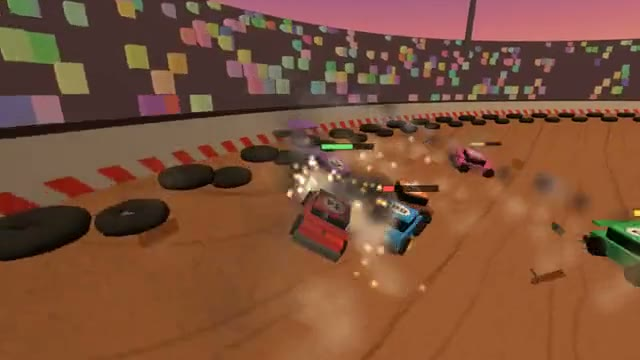

# Crash Derby

Ram, dent and wreck them. Last car running wins. A multiplayer starter game from [Multiplayer Agent](https://multiplayeragent.com): 3D, versus, 2–8 players, with bots that fill empty seats.

## How it plays

Everyone drives into one dirt bowl. Ram the other cars, side hits do the most damage, and boost in for a big one. Dents, smoke and loose parts show who is hurting; the last car still running wins.

**Controls:** Arrow keys or WASD to drive, Shift or Space to boost, or on-screen buttons.

## Make it yours in the Game Builder

Open the [Game Builder](https://multiplayeragent.com), choose **Start from a starter game** and pick Crash Derby. It opens as version 1 in your studio, ready to play and publish. Then ask for changes, for example:

- Add a ramp in the middle of the bowl
- Add a repair pickup that heals 30 health
- Make it a snowy ice rink where cars slide more

## Run it yourself

1. Get a free publishable key (`pk_…`) at [multiplayeragent.com](https://multiplayeragent.com).
2. In `index.html`, put it in place of `pk_REPLACE_ME` in the `MP_CONNECT` block.
3. Serve the folder (for example `npx serve`) and open it. The 3D engine loads as a module, which browsers block from a file on disk.

Without a key it still runs, offline against bots.

## How it is built

- One `index.html`, plus three.js in `libs/`. The comment at the top of the script maps the code and explains the multiplayer.
- **Leaderboard:** The best derby scores: damage dealt, wrecks and wins.
- **Host-run rounds:** The host's browser starts and ends each round; if it leaves, the next player takes over.
- **Bots:** Bots ram and dodge until enough people join.
- **Live sync:** Every car drives for everyone at once, and the car that gets hit works out its own damage.
- `?attract` runs it offline with bots only. The preview video is recorded from it.

## License

MIT.
